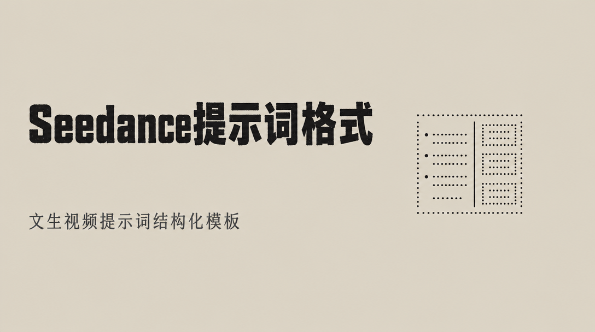
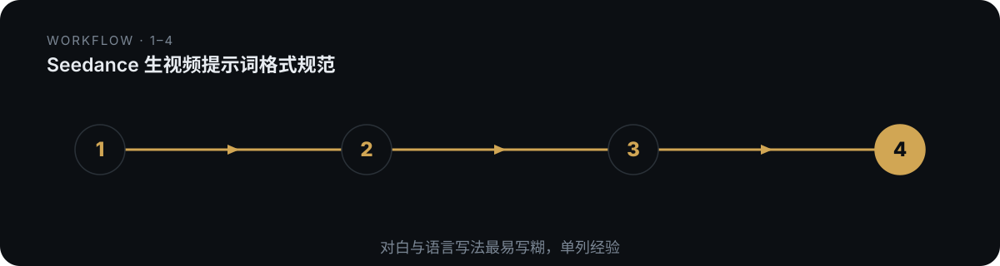

# domn-film-seedance-format



> 把散乱的剧情/素材/创意，重排成可直接喂给 Seedance/即梦的「七段式」生视频提示词（尤其管住最易写糊的对白与语言）。

## 真实产出样例

下面是这个技能**实际会产出**的东西（抽自仓库内的 references/ 真实交付样例），不是抽象描述：

```text
对白格式模板：
对白 角色名｜语言＋方言＋腔调｜声音质感/声道（可选：生僻字读音）
{台词原文}｜落点 起–止｜口型/表情/与画面事件同帧的绑定描述

【1.全局设定】范本首句：真实电影摄影机实拍的画面，实体道具与实体烟火药，白天晴空高光比，镜头有脏污，持机被事件打偏。
【4.执行契约】迟切（24fps）：接触帧 X，切点 Y，晚约 N 帧；三段依次留满才切——形变→失衡→代偿，接触时机位不换。
【7.负向约束】例：1.不要卡通渲染/游戏引擎质感 2.不要线稿白底平涂 3.不要字幕条水印 4.不要手指融合 5.不要 bgm
```

## 是什么

把散乱的剧情/素材/创意，重排成可直接喂给 Seedance/即梦的「七段式」生视频提示词（尤其管住最易写糊的对白与语言）。 本仓库是一个 Agent 技能（SKILL.md 为唯一权威定义），把上面的方法论沉淀为可被对话触发的可执行流程。

## 为什么不同

从 4 个电影级范例提炼出固定七段骨架，每段职责唯一；核心价值是「每个位置怎么写」的经验，尤其对白必须带齐语种+方言+腔调，且改写=按模板重排保意。

## 怎么做（工作流）

<p align="center">
  
</p>

> 每个位置怎么写；改写=按模板重排保意

1. **锁质感** — 第一句定死实拍/动画，排除三维/插画
2. **素材绑定** — @图片N 只定义 X、不得继承 Y
3. **画面契约** — 特征串+识别位+同框上限+惯性
4. **执行契约** — 速度/迟切/机制锁/轴线/摄影/音频(对白在此)
5. **场景+分段** — 地点光源+段内因果链+末：收尾
6. **负向约束** — 只拦最易翻车的 ≤5 条

## 怎么用

将本仓库放入支持 `SKILL.md` 的 Agent 技能目录：

- **WorkBuddy**：`~/.workbuddy/skills/domn-film-seedance-format/`
- **Codex / 其他**：对应 skills 目录

然后在对话中触发，例如：

```
用 domn-film-seedance-format 把这段分手戏改写成 9:16 Seedance 七段式提示词。
```

## 依赖

纯提示词方法论 + references/ 弹药库；生视频依赖文生视频模型（即梦 Seedance / Kling / 可灵等），提示词喂给这些模型执行。

## 仓库结构

```
domn-film-seedance-format/
├── SKILL.md                 # 技能定义（唯一权威）
├── assets/                  # 模板 / 占位素材
├── references/              # 方法论弹药库
└── assets/readme/           # 本 README 的视觉资产（hero.webp / workflow.svg）
```

## 许可

本仓库内容以 `SKILL.md` 为唯一权威定义。如附带 `LICENSE` 文件，以其为准。

---

*README 由 `beautify-github-readme` 生成 · 封面图来自作者作品集，强调色由封面采样派生；工作流图为每技能独立 motif。*